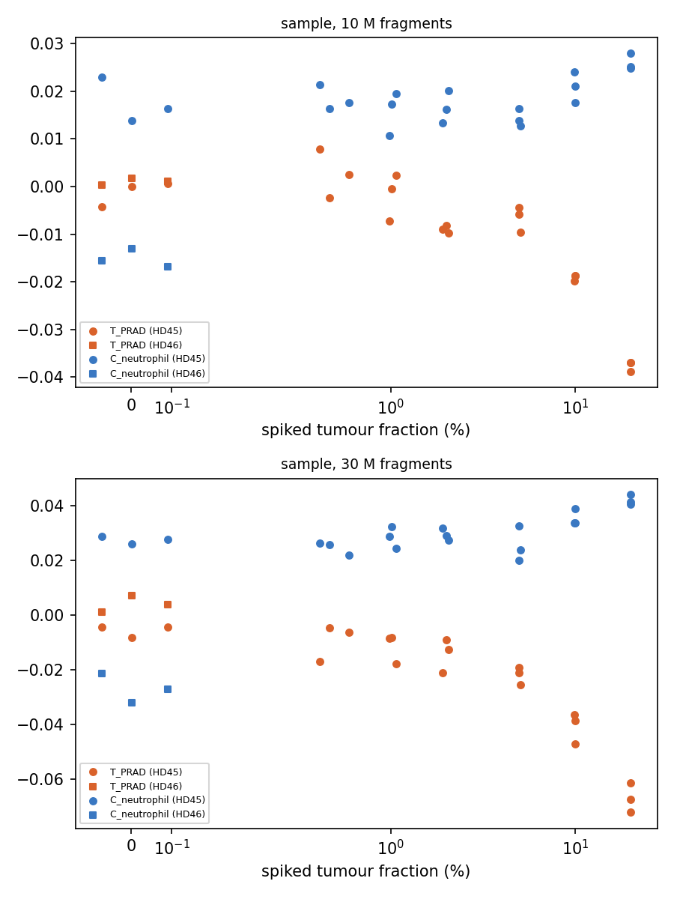
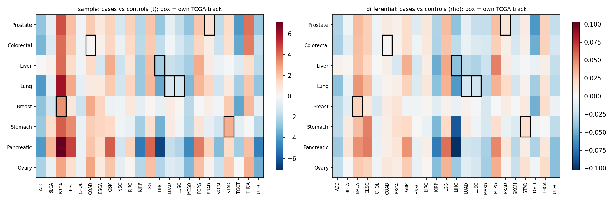

# Benchmarks (v0.2.0, 2026-11-05)

Benchmarks with known or expected answers, run with the `tumor` or `glioma` panel (layers C + T), modes `sample` and `differential` (`sets` was removed in 0.2.0; see [method](method.md#5-why-there-is-no-sets-mode)). Each run folder also has `ranked_<effect>.png` bar plots of every track. Scripts are in `benchmarks/`;
result tables in `benchmarks/results/`.

## 1. PRAD in-silico mixtures (hg19): does the method find tumour DNA, and how little?

**Design.** Fragments from a prostate cancer plasma sample (PRAD_14230, ichorCNA tumour fraction 46.5%) mixed into
a healthy person's plasma (HD45) at 0, 0.5, 1, 2, 5, 10 and 20% tumour fraction; 10 M and 30 M fragments; 3
replicates each. A second healthy person (HD46) at 0% shows person-to-person variation. Detection = all 3 replicates
beyond every unspiked sample (HD45 and HD46) at that depth. All files hg19 (native build of C and T).

| Depth | Mode | Spearman, T_PRAD vs tumour fraction | Rank of T_PRAD by \|rho\| among all 101 tracks | Detection limit |
|---|---|---|---|---|
| 10 M | sample | −0.88 | 1 | **2%** |
| 30 M | sample | −0.94 | 1 | **2%** |

- **T_PRAD is the most tumour-fraction-responsive of all 101 tracks** (TCGA, ENCODE tissues and cell types, groups) at both depths.
- **Direction: more tumour DNA lowers coverage at the tumour's specific open regions** (negative score). Read
  tumour tracks this way: lower = more tumour-derived signal.
- The removed `sets` mode (top-1,000 bins) had detection limits of 20% (10 M) and 5% (30 M).
- Caveat: the null has only two healthy people. The earlier benchmark with four people showed that person-to-person
  variation, not depth, sets the floor, so real-world limits will be higher than 2%.

**Differential mode on the mixtures** (spiked ≥ 5% vs unspiked, 9 vs 6 samples per depth):

| Depth | All-bins rho for T_PRAD (rank among all 101 tracks) | p | Top-2,000 "down" bins: T_PRAD specificity rank among 23 TCGA tracks | p |
|---|---|---|---|---|
| 10 M | −0.044 (most negative, 1st) | 0.005 | 1st of 23 | 0.015 |
| 30 M | −0.076 (1st) | < 0.005 | 1st of 23 | < 0.005 |

Differential mode recovers the tumour type too: bins that lose coverage with tumour DNA are the most PRAD-specific.

## 2. Cabat pan-cancer cohort (hg38): does each cancer light up its own track?

**Design.** 139 cases (pancreatic 28, lung 23, breast 22, prostate 21, colorectal 18, ovary 12, liver 8, stomach 7)
and 139 matched controls, QC-pass. Each cancer type vs all controls, adjusted for batch and sex; own TCGA track as
primary (pancreas / ovary have no TCGA track, so the ENCODE tissue was used). ichorCNA tumour fractions are mostly
below ~3%.

| Cancer | Own track | sample t (p) | differential rho (p) | Spearman of sample score with ichorCNA TF (cases) |
|---|---|---|---|---|
| Breast | T_BRCA | **3.18 (0.002), rank 1/23** | **0.023 (<0.001), rank 1/23** | −0.30 (p 0.18) |
| Stomach | T_STAD | **2.61 (0.012), rank 3/23** | 0.017 (0.03) | −0.18 (p 0.70, n 7) |
| Liver | T_LIHC | −2.49 (0.017) | −0.043 (0.01) | 0.55 (p 0.16, n 8) |
| Prostate | T_PRAD | 1.07 (0.28) | 0.013 (0.23) | −0.06 (p 0.80) |
| Colorectal | T_COAD | 0.21 (0.83) | 0.001 (0.84) | −0.17 (p 0.50) |
| Lung | T_LUSC / T_LUAD | −1.23 / −1.13 | n.s. | 0.13 / 0.18 |
| Pancreatic | C_pancreas | −0.83 | n.s. | 0.01 |
| Ovary | C_ovary | −3.93 (<0.001) | −0.086 (<0.001) | −0.22 (p 0.48) |

- **No diagonal.** Most cancer types share the same pattern of TCGA tracks (see the matrix rows), so the main
  case-vs-control difference in this cohort is common to all cancers, not tumour-type specific. At ichorCNA
  fractions of ~1–3%, tumour-specific DNA is near the detection limit found in benchmark 1.
- **Direction matters.** Benchmark 1 shows tumour DNA *lowers* the own-track score. Own-track changes in that
  direction: **liver** (T_LIHC, sample t −2.49, p 0.017; differential p 0.01) and **ovary** (C_ovary, negative in all
  three modes, p < 0.001). **Breast** (T_BRCA) and **stomach** (T_STAD) are significant in the *opposite* direction,
  so they are not tumour-derived signal; they follow the shared case/control shift.
- **No dose-response with ichorCNA tumour fraction within cases.** The own-track sample score is negative (the
  tumour direction) in 5 of 8 cancer types, but none is significant. (The removed `sets` mode had shown
  significant correlations for stomach and lung; they do not hold in the all-bins score.) At ichorCNA fractions of
  ~1–3% the tumour signal is below what this cohort can resolve.
- The shared pattern needs follow-up before biological interpretation: cases and controls may differ in collection
  era or processing, which no covariate here captures.

### Immune and blood tracks (ENCODE layer) in Cabat

| Track | Cases vs controls | Strongest (permutation p < 0.05) |
|---|---|---|
| B, NK, CD4 T, CD8 T, myeloid progenitor, spleen, thymus | lower in 94–100% of cancer type × mode tests | prostate (all, sample; B, NK, progenitor, spleen, thymus also differential), pancreatic (B, NK, progenitor, spleen, thymus), colorectal and lung (progenitor, spleen, thymus) |
| Neutrophil | lower (88%) | prostate (both modes), pancreatic and colorectal (sample) |
| Monocyte | slightly higher | stomach (sample t = 2.24) |

With the mixture-benchmark direction (more DNA from a cell type lowers coverage at its specific bins), cancer
plasma in this cohort carries relatively more blood-cell-derived cfDNA, especially lymphoid and progenitor, than
controls. This matches the shared, non-tumour-specific case/control shift seen on the TCGA tracks. Collection or
processing differences between cases and controls could produce the same pattern. Table:
`benchmarks/results/cabat_immune_tracks.csv`.

## 3. GBM cohorts (hg38, one library batch each)

| Comparison | Panel | n | Result |
|---|---|---|---|
| GBM (IDH-wt) vs schwannoma | glioma | 20 vs 16 | No glioma or CNS track significant in any mode (T_GBM sample t −0.03, p 0.97). Neutrophil lower in GBM (differential rho −0.087, p 0.04; q 0.36). |
| Metastatic breast vs schwannoma | tumor | 10 vs 16 | T_BRCA lower in the expected (tumour) direction in all modes, strongest in sample mode (t −1.80, p 0.08, rank 4/23); not significant at this n. Monocyte-specific bins over-represented among bins losing coverage (top-bin p 0.035). |
| Progression vs pseudo-progression | glioma | 5 vs 5 | Nothing significant (all q ≥ 0.84). |

GBM releases little tumour DNA into plasma, so the absence of a glioma signal is expected at these sizes;
the method does not invent one. The metastatic breast comparison points the right way but needs more samples.

## 4. Null calibration (Cabat controls, random labels)

| Mode | Runs | Mean share of tracks at p < 0.05 | Max in one run |
|---|---|---|---|
| sample | 10 | 5.0% | 16.8% |
| differential | 3 | 0.3% | 1.0% |

On average the per-sample modes are calibrated (~5%). Single runs can show many tracks at once because tracks are
correlated (one chance shift moves related tissues together); use the q-values and the primary-track correction.
Differential mode is conservative.

## Take-aways

1. The method recovers tumour-type-specific signal when tumour DNA is ≥ 2%, in both modes (`sample` per sample;
   `differential` at the group level), and the tumour track is the top responder among all 101 tracks.
2. Tumour tracks go **down** with more tumour DNA; a significant change in the other direction is not tumour signal.
3. In low-fraction real cohorts, expect shared, non-specific case/control shifts; pre-register tracks and check
   dose-response with an independent tumour-fraction estimate (ichorCNA) before interpreting.
